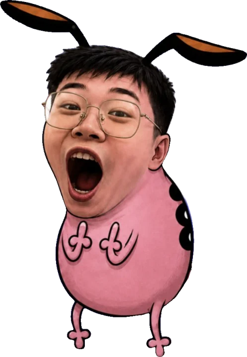
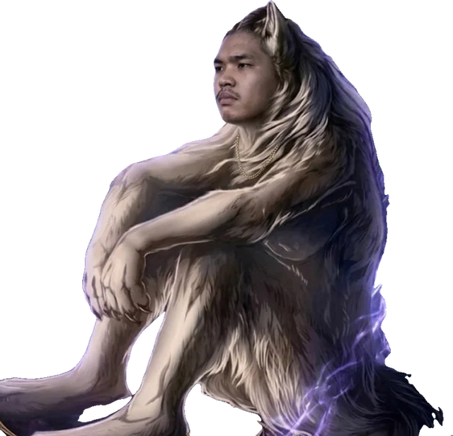
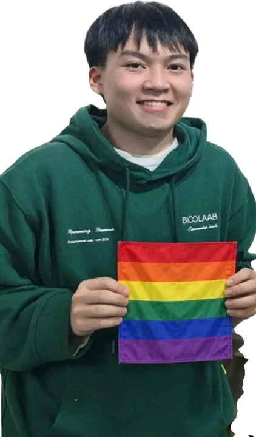
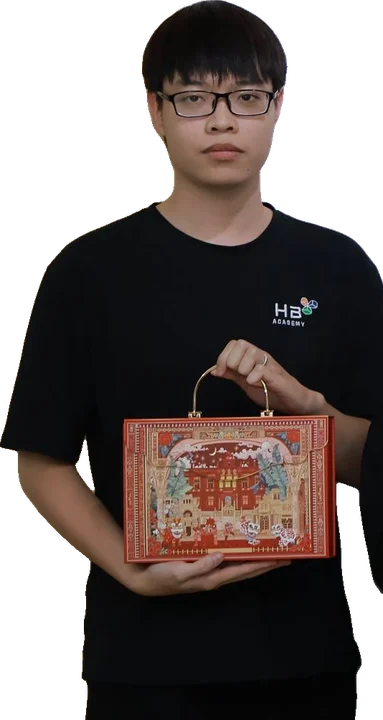
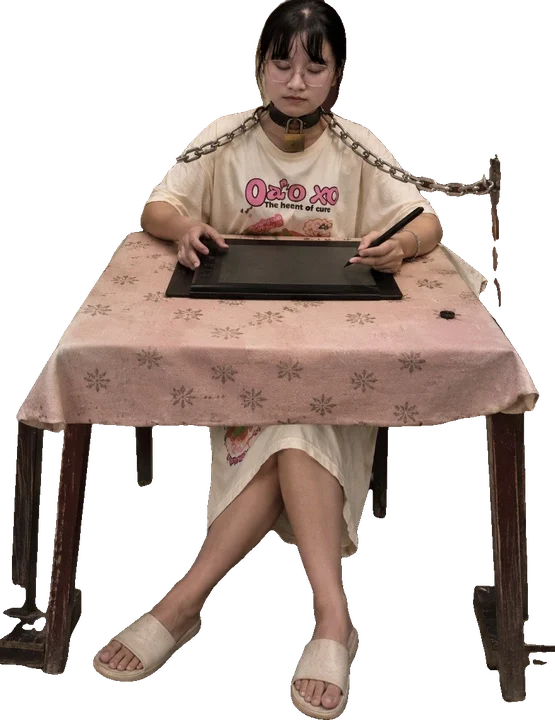

# Circle Chaos — Pool 19 nhân vật & màn chọn avatar

**Bản đề xuất để duyệt · v0.1 · 18/10/2026.** Chưa tích hợp vào game. Tất cả tên là biệt danh hư cấu tạm đặt theo tạo hình; số thứ tự trùng thứ tự 19 ảnh bạn gửi. Không suy đoán danh tính hoặc tính cách thật của người trong ảnh. Hài hước đến từ động tác, đạo cụ và tình huống.

## 1. Hướng thiết kế

Game hiện có 6 lớp cơ bản, vật lý nảy bi-a, tự đánh và Super ở 100 năng lượng. Đề xuất mở thành **19 nhân vật có bộ chiêu riêng**, dùng 6 lớp cũ làm khung chỉ số/vũ khí. Nhân vật không chỉ là skin của lớp. Mỗi người có một nội tại, một chiêu tự động theo hồi chiêu và một Super tự dùng. Người chơi chọn đội, trang bị và nâng cấp giữa vòng; không cần bấm chiêu trong trận.

Mỗi bộ chiêu ưu tiên một điểm dễ nhớ: hổ ngại va chạm, lốp tông đường thẳng, họa sĩ vẽ vùng, hộp quà đặt bẫy, cờ con giữ khiên. Hai nhân vật sắc màu được phân biệt bằng tăng tốc/tăng công và bảo kê/xóa chậm. Ba nhân vật quà Tết lần lượt đặt bẫy, chạy giao hàng và phát buff.

## 2. Màn chọn nhân vật: avatar phải hiện thật

- Hiện đủ 19 ô từ đầu, không dùng chữ viết tắt thay ảnh. Mỗi ô có ảnh gốc, tên, vai trò và trạng thái đang chọn. Bộ lọc: Tất cả / Đỡ đòn / Đấu sĩ / Xạ thủ / Kiểm soát / Hỗ trợ / Cơ động; một nhân vật có thể thuộc nhiều bộ lọc.
- Desktop: lưới bên trái, bảng chi tiết bên phải, 1–3 slot đội hình bên dưới theo cấu hình host. Mobile: lưới 3 cột, chạm mở bảng chi tiết phía dưới, nút “Thêm vào đội” cố định trong bảng; nút đóng và bàn phím vẫn dùng được.
- Chạm ô chỉ xem trước. Bấm “Thêm vào đội” mới ghi lựa chọn; bấm slot để xem hoặc thay đúng slot đó. Có nút gỡ. Số lượng slot theo host, không thêm quá giới hạn; thiếu slot thì chỉ rõ trước khi Sẵn sàng.
- Chi tiết gồm ảnh nguyên dáng dùng contain, tên, câu thoại, vai trò, HP/ATK/giáp/tốc độ, bốn mục Đánh thường / Nội tại / Chiêu tự động / Super, cách đối phó và một nâng cấp đề xuất. Hồi chiêu ghi bằng giây.
- Ô lưới ưu tiên mặt rõ; lưu crop/focus riêng mỗi ảnh khi triển khai, vì ảnh toàn thân và ảnh bán thân có tỷ lệ khác nhau. Chi tiết luôn hiện đầy đủ ảnh gốc, không cắt mất đạo cụ. Bản HTML duyệt dùng contain để đối chiếu đủ 19 nguồn.
- Avatar tiếp tục xuất hiện ở slot đội hình, danh sách trong phòng, màn chuẩn bị/trang bị, bảng kết quả và trong bóng tròn trên đấu trường. Trong trận dùng crop mặt, viền màu đội, dấu slot 1/2/3, HP và năng lượng ở ngoài; đạo cụ kỹ năng vẽ riêng để không che mặt. Hitbox vẫn tròn, kích thước ảnh không quyết định hitbox.
- Viền chọn + dấu tick + chữ “Đã chọn”; focus bàn phím rõ, không chỉ báo bằng màu. Ảnh lỗi dùng khung tên và mã nhân vật. Nút bật/tắt thoại, âm thanh và giảm hiệu ứng theo cài đặt hiện có. Lá cờ trong ảnh không thay màu nhận diện đội.
- Cho phép trùng nhân vật giữa các người chơi và giữa các slot như luật trùng lớp hiện tại. Slot và viền đội giúp nhận ra các bản sao. Không có rarity hoặc sức mạnh trả tiền.

## 3. Luật chung để đọc các bộ chiêu

**Thông số là mốc thử nghiệm cấp 1, chưa đo balance.** Bảng ghi HP / ATK / giáp / speed theo cùng đơn vị dữ liệu đang có. Khoảng cách kỹ năng dùng world unit của sân 1200 × 720. Hệ thống hiện lưu tọa độ theo scale 100; khi code phải chuyển đúng một lần. Tốc độ tham chiếu dải 330–600 đang có trong balance.ts; không diễn giải thành world unit/giây.

- 30 tick/giây. Chiêu thường bắt đầu hồi từ tick đầu vòng; chỉ dùng khi có mục tiêu trong tầm. Không có mục tiêu thì giữ trạng thái sẵn sàng, không tích nhiều lượt. Chiêu vùng đặt tại bản thân không cần chọn mục tiêu. Cùng tick ưu tiên Super, hoãn chiêu thường sang tick tiếp theo. Super chỉ dùng khi đủ 100 năng lượng, có mục tiêu hợp lệ nếu cần, và Super cũ đã hết.
- ATK trong công thức là attack sau cấp và trang bị; làm tròn xuống, rồi áp dụng giáp/khiên theo pipeline hiện tại. “Thêm 60% ATK” là cộng vào một hit trước giáp, không sinh thêm hit để farm năng lượng. Đòn tăng theo phần trăm cũng làm tròn xuống trước phòng thủ. Sát thương theo giây ghi rõ nhịp tick; vùng bắt đầu hit đầu sau đủ một nhịp, không thêm hit lúc tạo trừ khi ghi rõ.
- Chọn gần nhất theo khoảng cách tâm; hòa thì ID ổn định. Chọn thấp % HP so bằng tích chéo HP/maxHP, hòa theo khoảng cách rồi ID. Chỉ chọn người sống, đúng phe. Tầm chọn kiểm tra lúc cast; hiệu ứng đã đặt giữ vị trí trừ chiêu nói rõ đi theo hoặc theo dấu mục tiêu.
- Không friendly fire. Nguồn chết hủy đạn, bẫy, vùng, DoT và đòn đang chờ của nguồn như luật engine hiện tại. Khiên/buff đã cấp cho đồng minh tồn tại hết hạn. Không hồi sinh, tàng hình, teleport, hút xuyên tường hoặc phá tường bo.
- Lao nhanh vẫn đi qua solver từng tick, không đặt thẳng vị trí đích, không xuyên thân/tường. Hướng nhắm được lượng tử hóa 32 hướng. Đẩy lùi là xung vận tốc hướng ra khỏi nguồn có cường độ tương đương quãng đẩy mô tả khi thử trên sân trống; khoảng dời thực tế chịu tường, khối lượng và stability, không đảm bảo dời đúng số đơn vị.
- Buff cùng loại/cùng nguồn chỉ làm mới, không cộng dồn. Buff ATK và tốc độ từ nhiều nguồn chỉ lấy mức cao nhất của từng loại. Mỗi khiên là một lớp có nguồn và hạn dùng; các lớp cộng tối đa 100 điểm kỹ năng mỗi nhân vật, không tính khiên trang bị. Sát thương tiêu khiên hết hạn sớm nhất trước. Hết hạn xóa phần còn lại; khi đang chạm trần, lượng cấp vượt trần bị bỏ.
- Chậm lấy mức mạnh nhất, tối đa 35%; miễn chậm thắng chậm. “Ngắt tấn công” dừng đánh thường và khởi phát chiêu, không hủy Super đã chạy, không giữ đứng yên. Sau một lần ngắt được miễn ngắt tiếp 1 giây để tránh nhiều bọ khóa liên tục.
- Các lớp giáp cộng kỹ năng cùng tên chỉ lấy cao nhất. Tăng chỉ số dùng số nguyên phần trăm, thứ tự base → level → đồ → hiệu ứng tạm → clamp như game. Tốc độ có giới hạn engine; buff không bỏ giới hạn. Hồi HP không vượt maxHP, không tạo năng lượng. Khiên bị hấp thụ không tạo năng lượng; giữ trần nhận năng lượng 12/tick của hệ hiện tại.
- V1 không thêm hiệu ứng gốc của lớp lên trên bộ chiêu mới: mỗi nhân vật chỉ nhận bộ mô tả dưới đây. Ví dụ mượn khung frost không tự có chậm trên mọi đòn; mượn berserker không tự có hút máu ngoài mô tả. Vũ khí chính trong shop vẫn dùng quy tắc modifier hiện tại, không thay bộ chiêu định danh.

## 4. Danh sách nhanh

| Ảnh / ID | Tên tạm | Vai trò | Khung cũ | HP / ATK / Giáp / Speed |
|---|---|---|---|---|
| 01 / char_01 | Hổ Hướng Nội | Đỡ đòn / phản công | guardian | 330 / 16 / 10 / 350 |
| 02 / char_02 | Bé Ôm Bão | Đấu sĩ / áp sát | swordsman | 230 / 18 / 4 / 480 |
| 03 / char_03 | Anh Tím Mọng | Cấu rỉa / vùng chậm | frost | 195 / 15 / 4 / 440 |
| 04 / char_04 | Đùi Gió Lốc | Đấu sĩ / va chạm | berserker | 255 / 20 / 5 / 470 |
| 05 / char_05 | Kính Cận Bắt Bài | Xạ thủ / đánh dấu | ranger | 175 / 14 / 3 / 480 |
| 06 / char_06 | Đội Trưởng Sắc Màu | Hỗ trợ / tăng tốc | swordsman | 225 / 15 / 5 / 460 |
| 07 / char_07 | Bọ Hét Hết Hồn | Khống chế / quấy rối | frost | 205 / 14 / 4 / 520 |
| 08 / char_08 | Sói Suy Tư | Đấu sĩ / kết liễu | berserker | 245 / 21 / 4 / 450 |
| 09 / char_09 | Sếp Chốt Đơn | Kiểm soát / dồn sát thương | frost | 205 / 17 / 5 / 420 |
| 10 / char_10 | Lốp Lăn Ăn Vặt | Đỡ đòn / tông đẩy | guardian | 345 / 15 / 11 / 340 |
| 11 / char_11 | Cờ Con Cổ Vũ | Hỗ trợ / bảo kê | guardian | 280 / 14 / 8 / 380 |
| 12 / char_12 | Kiếm Khách Mượn Vai | Cận chiến / đánh mạnh theo nhịp | swordsman | 235 / 20 / 5 / 450 |
| 13 / char_13 | Mâm Quả Chủ Tịch | Hỗ trợ / hồi phục | ranger | 200 / 13 / 4 / 430 |
| 14 / char_14 | Hộp Quà Nghiêm Túc | Đặt bẫy / chặn đường | frost | 210 / 15 / 5 / 410 |
| 15 / char_15 | Hiệp Sĩ Gâu Gâu | Đỡ đòn / che chắn | guardian | 320 / 16 / 10 / 370 |
| 16 / char_16 | Họa Sĩ Chạy Deadline | Kiểm soát vùng / dựng đường đánh | frost | 195 / 16 / 4 / 410 |
| 17 / char_17 | Anh Tết Ship Nhanh | Cơ động / tăng nhịp đánh | assassin | 185 / 15 / 3 / 580 |
| 18 / char_18 | Ông Hoàng Nồi Lẩu | Đấu sĩ / sát thương vùng | berserker | 265 / 18 / 6 / 390 |
| 19 / char_19 | Cô Nàng Khui Tết | Hỗ trợ / nhịp khiên | swordsman | 220 / 15 / 5 / 450 |

## 5. Bộ chiêu từng nhân vật

### 01. Hổ Hướng Nội — Đỡ đòn / phản công

**Nhận diện:** Hổ ngồi xổm, mặt lim dim. **ID:** char_01. **Khung:** guardian.

**Câu chọn:** “Tui ngồi đây thôi, ai đụng tự chịu nha.”

**Chỉ số:** HP 330 · ATK 16 · Giáp 10 · Speed 350.

- **Đánh thường:** Đệm chân mèo khổng lồ xoay quanh người.
- **Nội tại — Đừng Đụng Tui:** Sau 3 lần va chạm thân với địch, đòn thường kế tiếp gây thêm 50% ATK và nhận 20 khiên trong 2 giây. Tối đa một lần mỗi 3 giây.
- **Tự động — Gầm Nhỏ Thôi:** Mỗi 7 giây, gầm trong bán kính 140: gây 70% ATK và đẩy địch 40 đơn vị. Hiện bong bóng “meo”.
- **Super — Hổ Báo Nhưng Ngại:** Trong 4 giây nhận 60 khiên; mỗi 1 giây quạt chân một lần, gây 70% ATK lên địch trong bán kính 110.
- **Điểm yếu / cách đối phó:** Chậm, bị cấu rỉa ngoài tầm; né vòng quạt và đợi khiên hết.
- **Nâng kỹ năng level 5 đề xuất:** Gầm Nhỏ Thôi: hồi chiêu 7 → 6 giây.
- **Hình / tiếng:** Vệt móng mềm, tiếng meo trầm, chữ “đã bảo đừng đụng”.

### 02. Bé Ôm Bão — Đấu sĩ / áp sát

**Nhận diện:** Đầu tóc bát úp trên thân trắng đang ôm mình. **ID:** char_02. **Khung:** swordsman.

**Câu chọn:** “Cho ôm cái… ủa sao văng rồi?”

**Chỉ số:** HP 230 · ATK 18 · Giáp 4 · Speed 480.

- **Đánh thường:** Hai cánh tay gối bông, tính như một vũ khí.
- **Nội tại — Càng Đông Càng Ấm:** Có ít nhất 2 địch trong bán kính 120 thì nhận +3 giáp. Không cộng dồn theo số địch.
- **Tự động — Ôm Một Miếng:** Mỗi 6 giây, hướng tới địch gần nhất trong 180, lao tối đa 100 đơn vị trong 0,3 giây; chạm địch đầu tiên gây 110% ATK và chậm 20% trong 1 giây.
- **Super — Ôm Cả Thế Giới:** Trong 4 giây, tay ôm xoay rộng thêm 25% tầm đánh; ba đòn thường trúng đầu tiên nhận thêm 50% ATK và hồi 8 HP mỗi đòn.
- **Điểm yếu / cách đối phó:** Cần áp sát, sợ đẩy lùi; không có địch trong tầm thì chưa lao.
- **Nâng kỹ năng level 5 đề xuất:** Ôm Một Miếng: sát thương 110% → 130% ATK.
- **Hình / tiếng:** Tim bông bật ra khi va chạm, tiếng bóp đồ chơi “chíp”.

### 03. Anh Tím Mọng — Cấu rỉa / vùng chậm

**Nhận diện:** Nhân vật ghép trái cây, tóc tím và áo trái mọng. **ID:** char_03. **Khung:** frost.

**Câu chọn:** “Đừng căng, làm ly vitamin đã.”

**Chỉ số:** HP 195 · ATK 15 · Giáp 4 · Speed 440.

- **Đánh thường:** Xiên nho xoay; đòn thường cận chiến.
- **Nội tại — Vitamin Vui Vẻ:** Đòn thường thứ tư trúng địch hồi 8 HP cho bản thân. Đếm theo lần trúng hợp lệ.
- **Tự động — Mứt Dính Dép:** Mỗi 7 giây thả một vũng tại vị trí địch gần nhất trong 260; báo trước 0,5 giây, bán kính 75, tồn tại 2 giây, chậm 25%, gây 30% ATK mỗi 0,5 giây.
- **Super — Sinh Tố Xoáy Lốc:** Tạo vùng bán kính 140 đi theo mình trong 4 giây: gây 40% ATK mỗi giây và chậm 20% cho địch.
- **Điểm yếu / cách đối phó:** Mỏng, sát thương cần đứng trong vùng; thoát vũng sớm để giảm tổn thất.
- **Nâng kỹ năng level 5 đề xuất:** Mứt Dính Dép: bán kính 75 → 85.
- **Hình / tiếng:** Mứt tím, hạt nho nảy và tiếng máy xay ngắn.

### 04. Đùi Gió Lốc — Đấu sĩ / va chạm

**Nhận diện:** Áo SUGOI, chân lực sĩ, giày thể thao. **ID:** char_04. **Khung:** berserker.

**Câu chọn:** “Ngày nào cũng là leg day!”

**Chỉ số:** HP 255 · ATK 20 · Giáp 5 · Speed 470.

- **Đánh thường:** Đôi giày xoay quanh thân như hai đầu của một vũ khí.
- **Nội tại — Chân Không Biết Mỏi:** Nảy tường đủ 3 lần thì nhận +15% tốc độ trong 2 giây; chỉ đếm một lần mỗi 0,5 giây.
- **Tự động — Đá Bay Dép:** Mỗi 6 giây đá một chiếc dép về địch gần nhất trong 320, gây 100% ATK và đẩy 35; đạn trúng một mục tiêu rồi biến mất.
- **Super — Leg Day Toàn Sân:** Trong 4 giây tăng 20% tốc độ; mỗi va chạm thân với địch gây 65% ATK, hồi riêng từng mục tiêu 0,8 giây.
- **Điểm yếu / cách đối phó:** Phụ thuộc đường nảy, dễ bị vùng chậm cắt nhịp.
- **Nâng kỹ năng level 5 đề xuất:** Đá Bay Dép: đẩy 35 → 45 đơn vị.
- **Hình / tiếng:** Vệt giày, tiếng “bộp”, bụi hình bắp chân.

### 05. Kính Cận Bắt Bài — Xạ thủ / đánh dấu

**Nhận diện:** Tóc ngắn, kính tròn, áo đen. **ID:** char_05. **Khung:** ranger.

**Câu chọn:** “Đứng yên… để tui nhìn rõ đã!”

**Chỉ số:** HP 175 · ATK 14 · Giáp 3 · Speed 480.

- **Đánh thường:** Bút laser bắn đạn thường theo nhịp xạ thủ.
- **Nội tại — Soi Rất Kỹ:** Đánh thường cùng một địch 3 lần liên tiếp: lần thứ ba thêm 40% ATK. Đổi mục tiêu sẽ đặt lại bộ đếm.
- **Tự động — Khoanh Đáp Án C:** Mỗi 7 giây đánh dấu địch gần nhất trong 300 trong 3 giây. Đòn thường của bản thân vào mục tiêu đó tăng 20% sát thương. Chỉ có một dấu.
- **Super — Bật Chế Độ Tập Trung:** Trong 4 giây, chu kỳ đòn thường giảm 25%; đạn thường xuyên thêm một địch, sát thương mục tiêu thứ hai bằng 60%.
- **Điểm yếu / cách đối phó:** Máu thấp; áp sát hoặc cản đường bắn, dấu không tăng damage đồng đội.
- **Nâng kỹ năng level 5 đề xuất:** Khoanh Đáp Án C: thời gian 3 → 4 giây.
- **Hình / tiếng:** Vòng kính lóe sáng, dấu khoanh tròn dễ đọc.

### 06. Đội Trưởng Sắc Màu — Hỗ trợ / tăng tốc

**Nhận diện:** Tóc xoăn, khoác cờ nhiều màu. **ID:** char_06. **Khung:** swordsman.

**Câu chọn:** “Lên màu nào, cả nhà ơi!”

**Chỉ số:** HP 225 · ATK 15 · Giáp 5 · Speed 460.

- **Đánh thường:** Ruy băng nhiều màu xoay quanh người.
- **Nội tại — Có Hội Có Hè:** Có đồng đội sống khác trong bán kính 180: bản thân +8% tốc độ. Không cộng dồn theo số người.
- **Tự động — Quẩy Đúng Nhịp:** Mỗi 8 giây, bản thân và đồng minh trong 160 nhận +12% tốc độ di chuyển và 16 khiên trong 2 giây.
- **Super — Đại Tiệc Sắc Màu:** Trong 4 giây tạo hào quang bán kính 180: đồng minh trong vùng được +10% ATK; lúc kích hoạt cấp 30 khiên cho đồng minh trong vùng, gồm bản thân.
- **Điểm yếu / cách đối phó:** Hiệu quả phụ thuộc đội đứng gần; solo vẫn tự nhận buff.
- **Nâng kỹ năng level 5 đề xuất:** Quẩy Đúng Nhịp: khiên 16 → 22.
- **Hình / tiếng:** Confetti nhiều màu gọn; kỹ năng xoay quanh bữa tiệc và tinh thần đồng đội.

### 07. Bọ Hét Hết Hồn — Khống chế / quấy rối

**Nhận diện:** Thân bọ hồng, râu dài, miệng đang hét. **ID:** char_07. **Khung:** frost.

**Câu chọn:** “ÁÁÁ… tui cũng giật mình!”

**Chỉ số:** HP 205 · ATK 14 · Giáp 4 · Speed 520.

- **Đánh thường:** Hai râu bọ quét như một vũ khí hai đầu.
- **Nội tại — Giật Mình Chạy Tiếp:** Sau khi mất tổng cộng 40 HP thực, nhận +15% tốc độ trong 1 giây; hồi 4 giây, chỉ tích sát thương khi hết hồi.
- **Tự động — Hét Vỡ Mood:** Mỗi 8 giây hét trong bán kính 130, gây 70% ATK và ngắt tấn công 0,5 giây. Di chuyển vật lý vẫn diễn ra.
- **Super — Mic Chưa Tắt:** Phát 3 sóng tại giây 0 / 1,5 / 3, bán kính 150; mỗi sóng gây 60% ATK và đẩy 25 đơn vị.
- **Điểm yếu / cách đối phó:** Không khóa di chuyển; giữ khoảng cách ngoài sóng để phản công.
- **Nâng kỹ năng level 5 đề xuất:** Hét Vỡ Mood: sát thương 70% → 90% ATK.
- **Hình / tiếng:** Sóng âm hồng, chữ “Á” nảy; âm lượng được giới hạn.

### 08. Sói Suy Tư — Đấu sĩ / kết liễu

**Nhận diện:** Sói ngồi trầm ngâm, ánh tím dưới chân. **ID:** char_08. **Khung:** berserker.

**Câu chọn:** “Trăng chưa lên, tâm sự đã đầy.”

**Chỉ số:** HP 245 · ATK 21 · Giáp 4 · Speed 450.

- **Đánh thường:** Vuốt sói có vệt trăng tím.
- **Nội tại — Càng Nghĩ Càng Đau:** Dưới 50% HP, bản thân +15% ATK. Không tăng thêm khi HP thấp hơn.
- **Tự động — Vồ Nỗi Buồn:** Mỗi 7 giây chọn địch ít phần trăm HP nhất trong 200; lao tối đa 110 đơn vị trong 0,3 giây, chạm địch đầu tiên gây 120% ATK.
- **Super — Trăng Lên Mood Xuống:** Trong 4 giây +15% tốc độ; đòn thường hồi 20% sát thương HP thực đã gây, tối đa 8 HP mỗi đòn.
- **Điểm yếu / cách đối phó:** Phải mạo hiểm khi thấp máu; khiên chặn sát thương cũng giảm hút máu.
- **Nâng kỹ năng level 5 đề xuất:** Vồ Nỗi Buồn: sát thương 120% → 140% ATK.
- **Hình / tiếng:** Trăng giấy tím, tiếng hú ngắn rồi thở dài.

### 09. Sếp Chốt Đơn — Kiểm soát / dồn sát thương

**Nhận diện:** Áo vest trắng, chống cằm. **ID:** char_09. **Khung:** frost.

**Câu chọn:** “Chốt nha. Không hoàn mood!”

**Chỉ số:** HP 205 · ATK 17 · Giáp 5 · Speed 420.

- **Đánh thường:** Tập hồ sơ xoay; đòn thường cận chiến.
- **Nội tại — Đọc Kỹ Điều Khoản:** Đòn thường của bản thân vào địch đang chậm gây thêm 15% sát thương.
- **Tự động — Mời Vào Họp:** Mỗi 7 giây đặt lịch dưới chân địch gần nhất trong 280, báo trước 0,6 giây; vùng bán kính 85 gây một lần 100% ATK và chậm 30% trong 1,5 giây.
- **Super — Deadline Dí Tới:** Chọn địch gần nhất trong 300; báo vòng giấy trên mục tiêu 1 giây, rồi nổ tại vị trí mục tiêu lúc đó, bán kính 100, gây 180% ATK. Nguồn hoặc mục tiêu chết trước nổ thì hủy.
- **Điểm yếu / cách đối phó:** Có thời gian báo trước; tách khỏi đồng đội để tránh nổ lan.
- **Nâng kỹ năng level 5 đề xuất:** Mời Vào Họp: hồi chiêu 7 → 6 giây.
- **Hình / tiếng:** Dấu “ĐÃ CHỐT”, lịch giấy; không liên quan giao dịch tiền thật.

### 10. Lốp Lăn Ăn Vặt — Đỡ đòn / tông đẩy

**Nhận diện:** Thân lốp xe đang cầm đồ ăn. **ID:** char_10. **Khung:** guardian.

**Câu chọn:** “Ăn miếng rồi lăn tiếp.”

**Chỉ số:** HP 345 · ATK 15 · Giáp 11 · Speed 340.

- **Đánh thường:** Hộp snack xoay quanh lốp.
- **Nội tại — Cao Su Có Số:** Giảm 25% độ đẩy lùi nhận vào, tính nhân với kháng đẩy từ trang bị.
- **Tự động — Cán Qua Drama:** Mỗi 8 giây khóa hướng tới địch gần nhất trong 240, tăng tốc 25% trong 1 giây; lần va chạm thân đầu tiên gây 130% ATK và đẩy 50, sau đó hết tăng tốc.
- **Super — Vòng Xoay Đói Bụng:** Trong 4 giây nhận 70 khiên; lần đầu chạm mỗi địch gây 100% ATK và đẩy 45. Mỗi địch chỉ bị hiệu ứng này một lần mỗi Super.
- **Điểm yếu / cách đối phó:** Dễ né khi đã khóa hướng; chậm sau cú tông hụt.
- **Nâng kỹ năng level 5 đề xuất:** Cán Qua Drama: hồi chiêu 8 → 7 giây.
- **Hình / tiếng:** Vệt bánh xe, vụn snack; không dùng logo thương hiệu làm icon kỹ năng.

### 11. Cờ Con Cổ Vũ — Hỗ trợ / bảo kê

**Nhận diện:** Hoodie xanh, cầm lá cờ nhiều màu. **ID:** char_11. **Khung:** guardian.

**Câu chọn:** “Bạn cứ đánh, tui giơ cờ!”

**Chỉ số:** HP 280 · ATK 14 · Giáp 8 · Speed 380.

- **Đánh thường:** Cán cờ bọc bông, màu đội hiển thị ở viền riêng.
- **Nội tại — Hội Cổ Vũ Một Người:** Đầu vòng cấp 20 khiên trong 5 giây cho đồng minh khác có HP tối đa thấp nhất. Nếu solo cấp cho bản thân.
- **Tự động — Phất Cờ Cứu Bồ:** Mỗi 8 giây chọn đồng minh thấp phần trăm HP nhất trong 220, gồm bản thân: cho 30 khiên trong 3 giây và xóa chậm hiện có.
- **Super — Không Ai Bị Bỏ Lại:** Bản thân và đồng minh trong bán kính 200 nhận 50 khiên trong 4 giây, miễn chậm 1 giây đầu.
- **Điểm yếu / cách đối phó:** Không hồi HP, khó cứu người ở xa; nhiều khiên không cộng vô hạn.
- **Nâng kỹ năng level 5 đề xuất:** Phất Cờ Cứu Bồ: khiên 30 → 38.
- **Hình / tiếng:** Cờ vẫy và ngôi sao cổ vũ; trò đùa nằm ở sự nhiệt tình.

### 12. Kiếm Khách Mượn Vai — Cận chiến / đánh mạnh theo nhịp

**Nhận diện:** Áo đỏ, đại kiếm vác trên vai. **ID:** char_12. **Khung:** swordsman.

**Câu chọn:** “Kiếm hơi nặng, cho mượn vai tí.”

**Chỉ số:** HP 235 · ATK 20 · Giáp 5 · Speed 450.

- **Đánh thường:** Đại kiếm xoay chậm, tầm nhỉnh hơn kiếm cơ bản.
- **Nội tại — Chém Có Bài:** Mỗi đòn thường thứ tư trúng địch gây thêm 60% ATK.
- **Tự động — Bổ Dưa Hấu:** Mỗi 6 giây vung kiếm theo hướng địch gần nhất trong 150; báo trước 0,3 giây, quét hình nón 90 độ, tầm 130, gây 120% ATK một lần.
- **Super — Một Nhát Cho Gọn:** Trong 4 giây ba đòn thường trúng đầu tiên xuyên 50% giáp và tăng 25% tầm; không tăng kích thước thân.
- **Điểm yếu / cách đối phó:** Nhịp ra đòn dễ đọc, cần đứng gần; đẩy ra trước khi bổ.
- **Nâng kỹ năng level 5 đề xuất:** Bổ Dưa Hấu: sát thương 120% → 140% ATK.
- **Hình / tiếng:** Vệt kiếm đỏ và miếng dưa minh họa, không máu me.

### 13. Mâm Quả Chủ Tịch — Hỗ trợ / hồi phục

**Nhận diện:** Áo đen, cầm mâm trái cây nhiều màu. **ID:** char_13. **Khung:** ranger.

**Câu chọn:** “Combat gì cũng phải có trái cây.”

**Chỉ số:** HP 200 · ATK 13 · Giáp 4 · Speed 430.

- **Đánh thường:** Ném quả nho như đạn thường.
- **Nội tại — Ăn Miếng Lấy Thảo:** Sau 5 đòn thường trúng địch, hồi 8 HP cho đồng minh thấp phần trăm HP nhất trong 180, gồm bản thân.
- **Tự động — Táo Đến Công Chuyện:** Mỗi 8 giây ném táo hồi 18 HP cho đồng minh thấp phần trăm HP nhất trong 240, gồm bản thân. Hiệu ứng bay chỉ là mỹ thuật, hồi ngay khi thi triển.
- **Super — Mâm Ngũ Quả Ngũ Phúc:** Trong 4 giây mở mâm bán kính 160; mỗi giây hồi 6 HP cho đồng minh trong vùng, gồm bản thân, tổng tối đa 24 HP mỗi người mỗi Super.
- **Điểm yếu / cách đối phó:** Hồi ít nhưng đều, yếu trước sát thương dồn; ép tách đội.
- **Nâng kỹ năng level 5 đề xuất:** Táo Đến Công Chuyện: hồi 18 → 22 HP.
- **Hình / tiếng:** Trái cây cười, pop-up “ăn đi cho khỏe”, không hồi ngoài giao tranh.

### 14. Hộp Quà Nghiêm Túc — Đặt bẫy / chặn đường

**Nhận diện:** Kính chữ nhật, áo đen, cầm hộp quà đỏ. **ID:** char_14. **Khung:** frost.

**Câu chọn:** “Quà nhỏ thôi. Mở ra hơi bất ngờ.”

**Chỉ số:** HP 210 · ATK 15 · Giáp 5 · Speed 410.

- **Đánh thường:** Nơ giấy quét quanh thân.
- **Nội tại — Đóng Gói Cẩn Thận:** Đầu vòng nhận 30 khiên trong 5 giây.
- **Tự động — Mở Ra Biết Liền:** Mỗi 7 giây thả hộp ở vị trí hiện tại, kích hoạt sau 0,5 giây, sống 5 giây. Địch chạm phạm vi 65 thì nổ bán kính 90: 110% ATK và chậm 25% trong 1 giây. Tối đa 2 hộp mỗi nguồn.
- **Super — Khui Hàng Đồng Loạt:** Đặt 3 hộp cách mình 90 đơn vị theo các hướng 0/11/21 trong bảng 32 hướng; báo 0,7 giây rồi nổ, mỗi hộp 90% ATK. Một địch nhận sát thương tối đa 2 hộp của lần Super này.
- **Điểm yếu / cách đối phó:** Bẫy hiện rõ, không đuổi người; đổi đường nảy để né.
- **Nâng kỹ năng level 5 đề xuất:** Mở Ra Biết Liền: thời gian tồn tại 5 → 6 giây.
- **Hình / tiếng:** Hộp rung, giấy vụn, tiếng “tèn ten”.

### 15. Hiệp Sĩ Gâu Gâu — Đỡ đòn / che chắn

**Nhận diện:** Trang phục hiệp sĩ xanh, tai chó, khiên dấu chân. **ID:** char_15. **Khung:** guardian.

**Câu chọn:** “Gâu một tiếng, yên tâm một trận.”

**Chỉ số:** HP 320 · ATK 16 · Giáp 10 · Speed 370.

- **Đánh thường:** Kiếm xương và khiên trang trí trên thân.
- **Nội tại — Trung Thành Có Khiên:** Có đồng minh sống khác trong 150 thì nhận +3 giáp. Không chặn hay chuyển sát thương của họ.
- **Tự động — Gâu Là Có Mặt:** Mỗi 7 giây chọn đồng minh thấp phần trăm HP nhất trong 220, gồm bản thân; cấp 28 khiên trong 3 giây, bản thân hướng vận tốc về phía họ nếu là người khác.
- **Super — Sân Nhà Của Gâu:** Trong 4 giây bản thân +4 giáp; mỗi giây tạo sóng bán kính 130 gây 45% ATK và đẩy địch 20.
- **Điểm yếu / cách đối phó:** Bảo kê trong tầm, không dịch chuyển tức thời; cấu rỉa ngoài vòng.
- **Nâng kỹ năng level 5 đề xuất:** Gâu Là Có Mặt: khiên 28 → 36.
- **Hình / tiếng:** Dấu chân, khiên xương, tiếng gâu vui; không đổi avatar sang nhân vật khác.

### 16. Họa Sĩ Chạy Deadline — Kiểm soát vùng / dựng đường đánh

**Nhận diện:** Ngồi bàn vẽ điện tử, cầm bút. **ID:** char_16. **Khung:** frost.

**Câu chọn:** “Để tui sửa nốt một nét… xong rồi!”

**Chỉ số:** HP 195 · ATK 16 · Giáp 4 · Speed 410.

- **Đánh thường:** Bút cảm ứng xoay; cả bàn chỉ là ảnh trang trí.
- **Nội tại — Ctrl Z Một Chút:** Lần đầu xuống dưới 40% HP mỗi vòng, nhận 35 khiên trong 3 giây. Không quay ngược HP hay vị trí.
- **Tự động — Vẽ Bừa Trúng Thiệt:** Mỗi 7 giây vẽ nét hướng tới địch gần nhất trong 260: dài 180, rộng 35, báo 0,5 giây, tồn tại 2 giây; gây 35% ATK mỗi 0,5 giây và chậm 20%.
- **Super — Xuất File Cuối Final:** Tạo vòng mực bán kính 150 tại vị trí mình lúc tung, tồn tại 4 giây; gây 50% ATK mỗi giây cho địch trong vùng. Vùng không đi theo người.
- **Điểm yếu / cách đối phó:** Cần địch đi qua nét; không tạo tường vật lý, né đường mực.
- **Nâng kỹ năng level 5 đề xuất:** Vẽ Bừa Trúng Thiệt: chiều rộng 35 → 45.
- **Hình / tiếng:** Mực neon, thanh “export 100%”, xích trong ảnh chỉ là chi tiết ảnh gốc.

### 17. Anh Tết Ship Nhanh — Cơ động / tăng nhịp đánh

**Nhận diện:** Sơ mi trắng, cầm túi quà đan có chữ Tết. **ID:** char_17. **Khung:** assassin.

**Câu chọn:** “Đơn Tết tới rồi, né ra cho ship!”

**Chỉ số:** HP 185 · ATK 15 · Giáp 3 · Speed 580.

- **Đánh thường:** Quai túi quà xoay tầm ngắn.
- **Nội tại — Đơn Hàng Đang Tới:** Sau khi nảy tường, đòn thường trúng kế tiếp trong 2 giây thêm 35% ATK; không tích nhiều lần, hồi 2 giây.
- **Tự động — Giao Hỏa Tốc:** Mỗi 6 giây hướng tới địch gần nhất trong 220, +30% tốc độ trong 1 giây; đòn thường trúng đầu tiên trong thời gian này thêm 60% ATK và kết thúc buff.
- **Super — Kịp Trước Giao Thừa:** Trong 4 giây +20% tốc độ, chu kỳ đánh giảm 20%, nhận 25 khiên lúc kích hoạt.
- **Điểm yếu / cách đối phó:** Mỏng, tăng tốc không xuyên thân hoặc tường; bị chậm sẽ hụt nhịp.
- **Nâng kỹ năng level 5 đề xuất:** Giao Hỏa Tốc: hồi chiêu 6 → 5 giây.
- **Hình / tiếng:** Tem giao hàng, chuông xe đạp và chữ “đã giao”.

### 18. Ông Hoàng Nồi Lẩu — Đấu sĩ / sát thương vùng

**Nhận diện:** Áo cổ lọ, cầm lì xì và hộp nồi lẩu. **ID:** char_18. **Khung:** berserker.

**Câu chọn:** “Bo có nhỏ, nồi lẩu vẫn đủ chỗ.”

**Chỉ số:** HP 265 · ATK 18 · Giáp 6 · Speed 390.

- **Đánh thường:** Muôi lẩu xoay quanh thân.
- **Nội tại — Càng Đông Càng Sôi:** Có ít nhất 2 địch trong 140 thì +12% ATK, không cộng theo số địch.
- **Tự động — Chan Nước Nóng:** Mỗi 7 giây hất nước hình nón 90 độ về địch gần nhất trong 180, tầm 150; gây 90% ATK ngay và 20% ATK mỗi giây trong 2 giây. Vết nóng không cộng dồn từ cùng nguồn.
- **Super — Lẩu Sôi Sùng Sục:** Đặt nồi tại vị trí hiện tại, báo 0,6 giây rồi tạo vùng 140 trong 4 giây, gây 55% ATK mỗi giây. Nồi không có thân va chạm.
- **Điểm yếu / cách đối phó:** Chậm, vùng cố định; thoát nồi trước khi sôi.
- **Nâng kỹ năng level 5 đề xuất:** Chan Nước Nóng: sát thương ban đầu 90% → 110% ATK.
- **Hình / tiếng:** Hơi nước, nấm nhảy; chữ trên hộp giữ trong ảnh gốc, không thành nhãn kỹ năng.

### 19. Cô Nàng Khui Tết — Hỗ trợ / nhịp khiên

**Nhận diện:** Áo đen, kính, cầm hộp quà đỏ trước người. **ID:** char_19. **Khung:** swordsman.

**Câu chọn:** “Khui nhẹ tay thôi, vui cả năm đó!”

**Chỉ số:** HP 220 · ATK 15 · Giáp 5 · Speed 450.

- **Đánh thường:** Dải nơ quà xoay.
- **Nội tại — Lộc Nhỏ Mỗi Ngày:** Sau 4 đòn thường trúng địch, cấp 12 khiên trong 2 giây cho đồng minh thấp phần trăm HP nhất trong 180, gồm bản thân.
- **Tự động — Lì Xì Lấy Hên:** Mỗi 8 giây chọn đồng minh thấp phần trăm HP nhất trong 220, gồm bản thân: cấp 20 khiên trong 3 giây và +10% ATK trong 2 giây. Không tác động Gold.
- **Super — Tết Này Có Hội:** Bản thân và đồng minh trong 180 nhận 35 khiên trong 4 giây; mỗi người nhận một phong bao khiến đòn thường trúng kế tiếp trong 4 giây thêm 60% ATK. Phong bao không cộng dồn.
- **Điểm yếu / cách đối phó:** Tầm hỗ trợ vừa, buff cần đánh trúng mới có giá trị; ép tách đội.
- **Nâng kỹ năng level 5 đề xuất:** Lì Xì Lấy Hên: khiên 20 → 28.
- **Hình / tiếng:** Phong bao, hoa giấy, tiếng “chúc mừng” ngắn.

## 6. Nâng cấp và đội hình gợi ý

Giữ nâng cấp level hiện tại (+18 HP, +2 ATK mỗi level, giá hiện tại). **Đề xuất một mốc nâng kỹ năng ở level 5**, tự áp dụng đúng một thay đổi ghi trong mỗi hồ sơ, không tăng theo level thêm lần nữa, không cần thêm nút mua. Chỉ mở mốc này sau khi balance bản cấp 1; đây chưa phải tính năng đã có.

Đội ba người để thử: **Hổ + Kính Cận + Cờ Con** (đỡ/cấu rỉa/khiên), **Bé Ôm + Đùi Gió + Đội Trưởng** (áp sát nhanh), **Lốp + Hộp Quà + Họa Sĩ** (đẩy vào vùng), **Sói + Anh Tết + Cô Khui Tết** (kết liễu theo nhịp), **Hiệp Sĩ + Nồi Lẩu + Mâm Quả** (giữ vùng/hồi phục). Đây là giả thuyết để test, không có buff ẩn khi ghép đúng bộ.

Solo: mọi chiêu hỗ trợ đều có tác dụng lên chính mình hoặc có fallback rõ; không có nhân vật mất toàn bộ chiêu vì chơi đội 1 người. Đội 2 người ưu tiên một người giữ nhịp và một người gây sát thương. Không khóa đội hình vào công thức cố định.

## 7. Hình ảnh, âm thanh và khả năng đọc trận

Sao chép đủ 19 PNG gốc vào docs/character-pool/avatars, đặt ID ổn định char_01–char_19. Giữ ảnh gốc để duyệt; crop khuôn mặt dùng metadata riêng khi triển khai, không sửa ảnh gốc. Nhân vật số 16 có bàn lớn, số 4 toàn thân và số 2 mặt rất to cần canh thủ công khi làm avatar trận.

Không cần tạo ảnh mới để thay các ảnh đã gửi. Icon chiêu nên dùng đạo cụ dễ nhận: vuốt / ôm / nho / giày / kính / ruy băng / loa / trăng / con dấu / lốp / cờ / kiếm / táo / hộp / khiên chân / bút / túi / nồi / phong bao. Bóng báo vùng dùng viền nét đứt trước nổ; vùng gây damage viền liền; màu đội chỉ nằm ở viền nhận diện. Giảm hiệu ứng bỏ confetti, giữ vòng báo và vùng ảnh hưởng.

Mỗi câu thoại là gợi ý nội dung, không yêu cầu dùng giọng thật của người trong ảnh. Không phát chồng 60 câu khi bắt đầu: tối đa một câu mỗi giây toàn client, ưu tiên đội mình. Nút tắt âm áp dụng cả thoại. Chỉ âm thanh/mỹ thuật dùng random riêng, không làm thay đổi RNG trận.

## 8. Phạm vi kỹ thuật sau khi duyệt

Hiện có ClassId cho 6 lớp; thêm CharacterId riêng cho 19 người và giữ classId làm khung vũ khí/chỉ số. Chọn nhân vật phải truyền characterId qua UI → schema action → room/loadout → snapshot → engine → replay/renderer, không chỉ đổi label frontend. Đổi phiên bản engine/protocol tương ứng khi luật chiến đấu thay đổi để tránh replay cũ phát sai. Đây là kế hoạch, chưa đổi file nguồn.

Cần thêm state cho cooldown chiêu, bộ đếm nội tại, buff có nguồn/hạn, khiên từng lớp, delayed cast và bẫy. Tất cả phải serialize trong checkpoint; thứ tự xử lý theo ID/tick, không dùng đồng hồ hoặc Math.random. Hệ đạn hiện có trần 240; thêm bẫy/vùng phải có trần cấu hình và cách xử lý khi chạm trần (khuyến nghị bỏ lần tạo mới, vẫn tiêu hồi chiêu), không tạo object vô hạn. V1 đề xuất tối đa 180 bẫy/vùng tồn tại toàn trận; chiêu đặt nhiều vùng tạo theo thứ tự cố định đến khi hết chỗ.

Đề xuất triển khai theo lát cắt: (1) avatar và chọn đủ 19 hồ sơ; (2) bộ chiêu cho Hổ, Kính Cận, Kiếm Khách, Lốp để xác nhận đường dữ liệu; (3) hỗ trợ, vùng/bẫy và các bộ còn lại; (4) mốc level 5. Khi mới hoàn thành bước 1, UI phải ghi bộ chiêu đang thử nghiệm/chưa có, không trình bày chiêu đề xuất như đã chạy.

## 9. Tiêu chí nghiệm thu & balance

- Đủ 19 ảnh ở chọn đội và đúng avatar trên sân/kết quả; kiểm tra 1/2/3 slot, trùng nhân vật, ảnh lỗi, thay/gỡ, bàn phím và màn nhỏ 360 px. Không cắt mặt/đạo cụ quan trọng trong bảng chi tiết.
- Mỗi chiêu có test về tick thi triển, hồi chiêu, mục tiêu hòa khoảng cách, nguồn chết, hạn vùng, stack khiên/buff và giới hạn object. Replay cùng seed phải cùng hash sau resume checkpoint; các cơ chế mới không vượt bo hoặc đi xuyên hitbox.
- Chạy tối thiểu 200 seed cho mỗi cặp solo 19 nhân vật (171 cặp), hoán đổi vị trí spawn; thêm trận tự đấu cùng nhân vật để phát hiện thiên lệch vị trí. Thử riêng đội 3 người, đội nhiều hỗ trợ, đội ba bản sao và stress 60 bóng. Ghi damage, hồi HP, khiên thực hấp thụ, số Super, thời lượng, tỷ lệ thắng; không chỉ nhìn tổng damage.
- Dải tham chiếu ban đầu: win rate solo trung bình trên tập đối thủ 45–55%, không yêu cầu mọi cặp đều 50%; hỗ trợ phải được xem thêm theo đội. Lệch thì chỉnh hệ số/hồi chiêu trước, giữ lại bản sắc chiêu.
- Trận vẫn không có giới hạn thời gian. Chạy test độ sống dai dài sau khi bo dừng, đặc biệt nhiều hỗ trợ; ngân sách test tối đa 10 phút mô phỏng chỉ để báo lỗi/balance, không dùng để quyết thắng trong gameplay. Nếu heal/khiên kéo dài quá mức, giảm lượng hoặc tăng hồi chiêu trước khi phát hành.
- So sánh benchmark và replay determinism với bản hiện tại; không hứa bộ 19 chạy tốt chỉ từ tài liệu này.

## 10. Những điểm cần bạn duyệt

1. Giữ/đổi biệt danh nào trong 19 người? Có thể phản hồi theo số ảnh, ví dụ “01 đổi tên…, 10 giữ chiêu…”.
2. Duyệt hướng mỗi người có nội tại + một chiêu tự động + một Super; không thêm nút bấm lúc đánh.
3. Duyệt vai trò và phong cách hài; đặc biệt hai nhân vật cờ, các nhân vật quà và câu thoại.
4. Duyệt avatar ở lưới chọn, ảnh nguyên dáng trong chi tiết và crop mặt trên bóng.
5. Duyệt thử mốc nâng kỹ năng level 5 sau khi cân bằng cấp 1.

**File này và bản HTML là hồ sơ đề xuất. Gameplay, giao diện game đang chạy và dữ liệu người chơi chưa bị sửa.**
